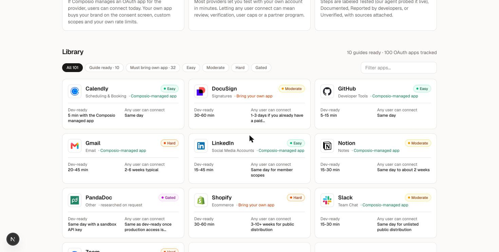
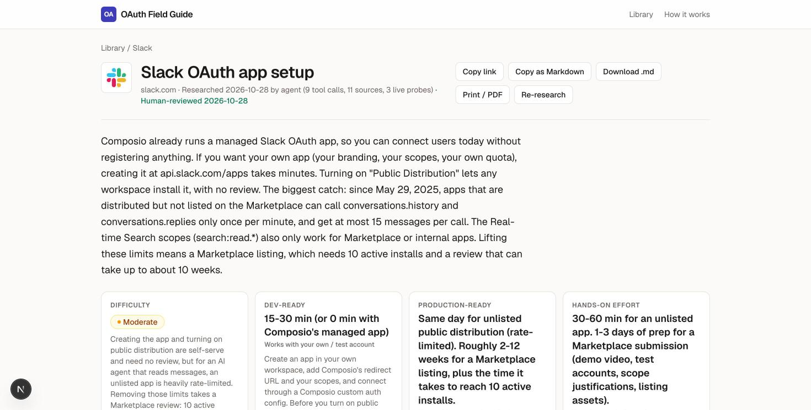
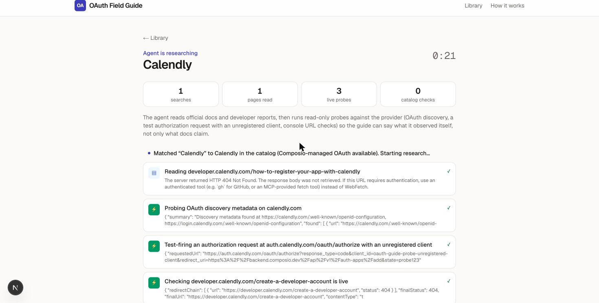

# OAuth Field Guide

**Will your users be able to connect it next week, or in two months?**

A library of OAuth app setup and approval guides for 100 apps, plus a research agent that writes a new guide live for any app you name. Each guide tells a developer building an AI agent:

- whether they need their own OAuth app at all (Composio may already manage one),
- how hard it is, with two separate timelines: **dev-ready** (works with my own or a test account) and **production-ready** (any user can connect, including the approval wait),
- the steps, each tagged with **who does it** (an agent, an agent with you logged in, or only you) and **how we know** (tested live, documented, reported by developers, or unverified),
- what blocks approval and how to get past it, plus drafts of the review text they'd otherwise write by hand,
- the sources, the live probes the agent ran, and what is still uncertain.

Guides can be shared as a link, copied as Markdown, downloaded as `.md`, or printed to PDF. A step checklist remembers your progress in the browser.

| Library | Guide | Live research |
|---|---|---|
|  |  |  |

## Run it

Requirements: Node 20+, and the [Claude Code CLI](https://docs.claude.com/en/docs/claude-code) installed and logged in (`claude` on your PATH). There's no API key to configure: the research agent runs `claude -p` in headless mode with your existing login.

```bash
npm install
npm run dev          # http://localhost:3000
```

- Browse the library, or type any app name or website into the box (try an app outside the 100, e.g. `pandadoc.com`). A guide takes about 2–4 minutes.
- Batch-generate library guides from the command line (same code path): `npm run generate -- notion "Google Calendar" xero --concurrency 3`
- Rebuild the 100-app catalog from Composio's public toolkit data: `npm run catalog`
- Optional settings are in `.env.example` (model, CLI path, timeout, concurrency).

## How it works

```
Browser ── POST /api/generate ──► job (in-memory) ──► claude -p  (headless Claude Code)
   ▲                                   │                 ├─ WebSearch / WebFetch      official docs, developer reports
   └── SSE /api/jobs/:id/events ◄──────┘                 ├─ MCP: agent/probe-server   read-only live probes
                                                         └─ --json-schema             structured guide output
                                       ▼
                         data/guides/<slug>.json  ──►  /guides/<slug>  (+ Markdown export)
                         data/reviews/<slug>.json      human review, pinned to the guide version it checked
```

- **`src/lib/agent/prompt.ts`**: the research brief: dev-ready vs production-ready, evidence rules, owner definitions, and verified Composio facts so the agent doesn't re-derive them.
- **`agent/probe-server.mjs`**: a small MCP server that gives the agent first-hand evidence:
  - `oauth_discovery` fetches OIDC / RFC 8414 metadata (PKCE methods, scopes, whether dynamic client registration is offered).
  - `oauth_authorize_probe` sends one authorization request with a deliberately unregistered client ID and Composio's redirect URI, and records how the provider reacts.
  - `http_probe` checks that console and docs URLs exist and whether they need a login.
  - `composio_lookup` reads Composio's catalog: managed app or bring-your-own, redirect URI, default scopes.

  Probes are read-only and limited to public hosts. They never log in, register apps, submit forms or call registration endpoints.
- **`src/lib/guide.ts`**: the guide schema. The CLI validates the agent's output against it (`--json-schema`), and citations pointing to sources that aren't in the list are dropped.
- **`data/catalog.json`**: 100 OAuth apps picked from Composio's 382 OAuth toolkits (`docs.composio.dev/data/toolkits.json`), weighted toward the 32 where Composio has no managed app.

## Key decisions

1. **"Do you even need your own app?" comes first.** 68 of the 100 apps have a Composio-managed OAuth app, so users can connect today. The guide says so up front and frames a custom app as a choice (your brand on the consent screen, custom scopes, your own quota). For the other 32, it says plainly that you must register one.
2. **Two timelines, never one.** Developers misjudge integrations because "I got OAuth working in 20 minutes" says nothing about getting any user connected. For example, Gmail is a 30-minute setup but a 2–6 week verification plus an annual paid security assessment. Slack is same-day, but unlisted apps are rate-limited to 1 history call per minute until they get through a Marketplace review that can take up to 10 weeks.
3. **Evidence labels on every claim.** *Tested* means the agent observed it during the run. *Documented* means it's on an official page the agent fetched. *Reported* means community sources only. *Unverified* means inferred. A guide that sounds equally sure about everything can't be trusted on anything.
4. **Agent / agent-assisted / you on every step.** This is the honest answer to "what can an agent do for me": research, scope selection, drafting justifications and policy text, building the auth config, and driving console forms while you're logged in. Identity and business verification, legal terms, payments, demo videos and 2FA stay with you. Drafts of review text are included because that's where approvals stall.
5. **One pipeline for the library and live requests.** Library guides are agent output, generated by the same code a live request uses, so quality checks on the library apply to live guides too. Guides are JSON files, so a review is a readable diff.
6. **Human review is versioned.** Review notes live in `data/reviews/` and only attach to the exact guide version they checked. Re-researching a guide drops the "human-reviewed" badge instead of putting it on content nobody checked.
7. **Focused scope.** I put the effort into guide quality, evidence and the live flow, not breadth. There are 11 guides across all four difficulty levels (easy: GitHub, Calendly, LinkedIn; moderate: Slack, Notion, DocuSign, Google Calendar; hard: Gmail, Shopify, Zoom; gated: PandaDoc, which isn't in the catalog and was researched live), and the other catalog apps generate on demand. Each guide took 1.5–3 minutes and 7–14 tool calls, including 3–5 live probes.

## What I verified, and what it changed

I checked 3 of the agent's guides claim by claim against official docs and re-ran the agent's probes myself. The full log is on `/methodology` and inline on each guide.

| Guide | Checked | Confirmed | Corrected | Flagged |
|---|---|---|---|---|
| Gmail | Google help center, OAuth docs, Nango's Google review guide | annual CASA reassessment, 7-day refresh tokens in Testing, 2–6 week timeline | CASA cost attributed to "Google's docs" (Google publishes no price; it's vendor pricing); granular consent (Jan 2026) missing; 100-refresh-token cap missing | – |
| LinkedIn | Microsoft Learn LinkedIn docs | 60-day tokens with refresh only for MDP partners, Share limits (150/member, 100k/app/day), Community Management dev-tier caps, no re-apply after rejection, version sunset date | one step labeled *Documented* that rested on community reports | "Community Management API must be alone on its app" and the 21-day survey window: not in official docs |
| Slack | Slack changelog and Marketplace review guide, re-run probes | non-Marketplace rate limits and dates, 10 active workspaces, 10-business-day and 10-week review windows, all three probe results reproduced | – | whether Composio's managed Slack app is Marketplace-approved (decides if the rate limit applies to it) |

**What this taught me:** the numbers and policies were right. The failures were about *attribution* (a vendor's price presented as Google's), *label inflation* (a step tagged with the strongest evidence in it rather than the weakest), and *missing recent changes*. I added three rules to the system prompt to address each of these. The LinkedIn "Easy" rating looked wrong at first. It turned out to be right for Composio's default self-serve scopes, and the guide spells out that Company Page scopes are gated.

## Limitations

- **No logged-in setup attempts.** The agent can't create accounts or register apps, so anything behind a provider login is *documented* or *reported*, never *tested*. The next step would be a browser agent that registers a test app with a real developer account, with the developer approving each step.
- **Review timelines vary.** Ranges come from provider statements and developer reports, not from submitting apps.
- **Runs locally.** Live research uses the local Claude Code CLI, and jobs are held in memory (a server restart drops running jobs; finished guides are on disk). To host it, swap the runner for the Claude Agent SDK or Messages API with an API key, and keep guides in a database or blob store.
- **Probes are shallow by design.** They show endpoints are live and how unknown clients are treated. They can't see user caps, review queues or console UI.
- **Guides go stale.** Every guide shows its research date, and "Re-research" regenerates it.

## Repo layout

```
agent/probe-server.mjs        read-only MCP probe tools
data/catalog.json             100-app catalog (from Composio's public toolkit data)
data/guides/*.json            generated guides
data/reviews/*.json           human review notes, pinned to a guide version
scripts/build-catalog.mjs     rebuild the catalog
scripts/generate.mts          batch-generate guides
src/lib/agent/                prompt + runner (spawns `claude -p`, streams events)
src/lib/guide.ts              guide types + JSON schema
src/app/                      Next.js pages and API routes
```
